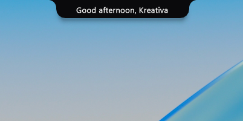
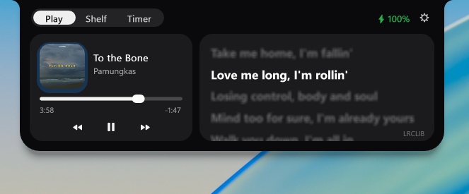
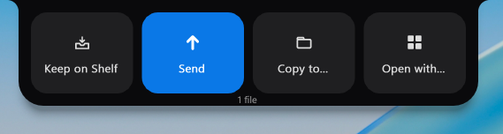
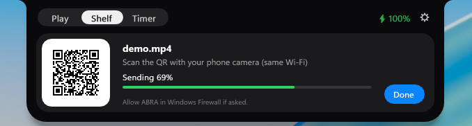
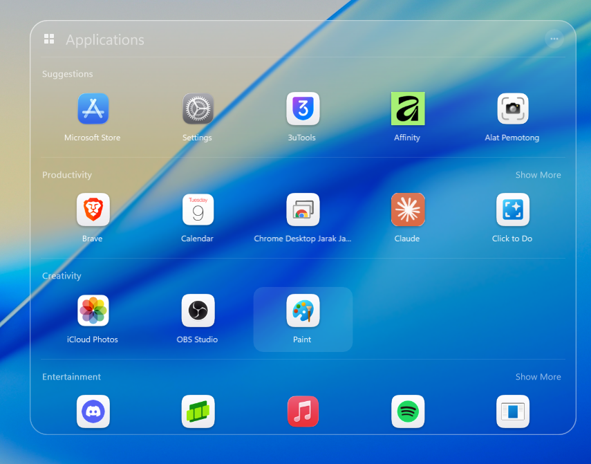

<p align="center">
  
</p>

<h1 align="center">ABRA</h1>

> [!IMPORTANT]
> **Disclaimer.** ABRA is an independent, fan‑made project. It is **not affiliated with, endorsed by or sponsored by
> Apple Inc.** in any way. ABRA uses its own names (Deck, Visor, Rail, Scene, Quick Search, Quick Panel, Crystal and so on).
> “Apple”, “macOS”, “Tahoe”, “Liquid Glass”, “Dynamic Island”, “Stage Manager”, “Mission Control”, “Spotlight”,
> “Launchpad”, “AirDrop”, “AirPlay” and related names are trademarks of Apple Inc. ABRA ships no Apple code, icons,
> fonts or other assets.

<p align="center">
  <b>A modern glass desktop for Windows 11.</b><br>
  Deck · Visor · Rail · Quick Panel · Quick Search · Scene · Widgets — native, written in Rust, about 15 MB of RAM.
</p>

<p align="center">
  <a href="https://github-release-stats.ghostbyte.dev/abdeealfarizi/abra"></a>  
  
  
  
  <a href="https://saweria.co/kreativadev"></a>
</p>

<p align="center">
  <a href="#-install">Install</a> ·
  <a href="#-how-to-use-each-feature">How to use</a> ·
  <a href="#-modular-turn-off-what-you-dont-want">Modular</a> ·
  <a href="#-privacy">Privacy</a> ·
  <a href="#-built-with">Built with</a> ·
  <a href="#-build-from-source">Build</a> ·
  <a href="#-support-abra">Support</a>
</p>

---

## ✨ What is ABRA?

ABRA turns Windows 11 into a clean, modern desktop:

- a magnifying **Deck** for your apps,
- a **Visor** at the top of the screen that shows what is going on (music with live lyrics, downloads, timers, files),
- a **Rail** with real app menus, Wi‑Fi and battery,
- a **Quick Panel** for toggles and sliders, **Quick Search**, **Scene**, **Overview** and desktop **Widgets**,

all drawn with a frosted glass material and springy animations.

It is one small native program: no Electron, no web view, no background services, no account. At idle it uses about
**15 MB** of private memory.

<p align="center">
  
</p>

### 🆕 New in 0.4.1

- **New look out of the box**: a fresh install now starts with the Rail, Visor and Deck together, with an auto‑hiding
  Deck. Settings you already changed are kept.
- **Fixes**: the Visor battery percentage keeps updating instead of freezing after the first reading, and the Wi‑Fi and
  Bluetooth controls in the Quick Panel open their menus again instead of closing straight away.

### In 0.4.0

- **Desktop widgets**: Clock, World Clock, Today, Month, Digital Clock, Battery and System Monitor, in the **Original** or
  **Crystal** material. Add them from a widget gallery; they snap to a tidy grid with a placeholder while you drag.
- **Capsule**: an optional floating, pill‑shaped Visor.
- **Global scale** (100 · 125 · 150%) for the Deck, Visor, Rail and Quick Panel.
- **Quick Panel editing**: drag controls to rearrange them (neighbours slide out of the way) and drag the glass corner
  handle to resize any control — Wi‑Fi down to a single circle, sliders vertical or wide, Playing from a play button up
  to a large card.
- **Wi‑Fi**: connect to your saved networks without location access, live signal strength, and new Wi‑Fi and battery icons
  in the Rail with the battery percentage inside, outside or hidden.
- **Windows** open and close with an animation; Scene cards fly in from where they sit.
- **Settings** redesigned with a floating glass sidebar, and your own image as the Rail logo.
- **Own names** for every part: Deck, Visor, Rail, Scene, Quick Search, Quick Panel, Overview and App Grid.
- **Fixes**: Deck pins survive app updates (Microsoft Store and auto‑updating apps), closed apps can be removed from the
  Deck, opening apps no longer freezes ABRA, the Visor and Deck always stay above other windows, and text can no longer be
  garbled by third‑party fonts.
- **Lighter**: about a third of the memory of the previous development build.

<details>
<summary><b>In 0.3.0</b></summary>

- A brand‑new Visor with **Play**, **Shelf** and **Timer** tabs, live lyrics, a music idle mode and download progress.
- **Send to phone**: drop files on the Visor and scan a QR code with any Android or iPhone.
- Wi‑Fi and Bluetooth pickers, the ABRA app icon and a **Buy me a coffee** button.
</details>

---

## 🧩 Modular: turn off what you don’t want

Every part of ABRA is independent. Keep only the pieces you like:

| Part | Where to turn it off |
|---|---|
| Deck | *Settings → Deck → Enable Deck* |
| Visor | *Settings → Visor → Enable Visor* |
| Rail | *Settings → Rail → Enable Rail* |
| Widgets | Right‑click a widget → *Remove Widget* |
| Scene | *Settings → Scene*, or the Quick Panel control |
| Screen Corners | *Settings → Screen Corners* (set each corner to “None”) |
| Windows taskbar | *Settings → General → Hide the Windows taskbar* (turn off to keep your taskbar) |
| Window animations | *Settings → General → Window animations* |
| Recent apps in the Deck | *Settings → Deck → Recent apps* |

Use only the Deck with your normal taskbar, only the Visor, only the Rail — any mix works.

---

## 🚀 Install

> Requires **Windows 11** (build 22000 or newer), 64‑bit.

Download from the **[Releases](https://github.com/abdeealfarizi/abra/releases)** page:

| File | Best for |
|---|---|
| `ABRA-Setup-0.4.1.exe` | Most people. Per‑user install, **no administrator rights**, optional Start menu shortcut and “launch at sign‑in”, clean uninstall from *Windows Settings → Apps*. |
| `ABRA-0.4.1-win-x64.zip` | Portable. Extract anywhere and keep `abra.exe`, `abra-guard.exe` and the `fonts` folder **together**. |

### Installer

1. Run `ABRA-Setup-0.4.1.exe`.
2. Windows SmartScreen may warn about an unsigned app: choose **More info → Run anyway** (only for files from this repository).
3. Pick the options you want (Start menu shortcut, launch at sign‑in) and finish. ABRA starts.

### Portable

1. Extract the zip to a folder you keep, for example `Documents\ABRA`.
2. Double‑click `abra.exe`.

### First run

- The Windows taskbar hides and the Rail, Visor and Deck appear. The Deck hides itself until you move the pointer to the
  bottom of the screen (turn the takeover off in *Settings → General* if you prefer your taskbar).
- Open **Settings**: right‑click the Deck → **ABRA Settings…**, or click the logo in the Rail.
- Language: *Settings → General → Language* (**English**, **Indonesia** or **Español**).

### Updating from an older version

Install 0.4.1 over the old version. Your settings, pinned apps and Quick Panel layout are kept.

### Quit and uninstall

- **Quit**: right‑click an empty part of the Deck (or the Start icon) → **Quit ABRA**. The taskbar comes back automatically.
  If ABRA is ever killed, `abra-guard.exe` restores the taskbar and any windows it moved.
- **Uninstall**: *Windows Settings → Apps → Installed apps → ABRA → Uninstall* (installer), or quit ABRA and delete the folder
  (portable). Your settings are in `%APPDATA%\ABRA`; delete that folder too for a clean removal.

---

## 📖 How to use each feature

<details open>
<summary><b>🎛 Deck</b></summary>

- **Open / switch apps**: click an icon. Running apps have a dot. Hover to magnify; hover a running app for live window previews.
- **Keep / remove**: right‑click an app → *Keep in Deck* / *Remove from Deck*. Drag icons to reorder.
- **Recent apps** you closed appear on the right; right‑click → *Remove from Deck*, or turn them off in *Settings → Deck*.
- **Close an app**: right‑click it → **Close**. **Quit ABRA** appears when you right‑click an empty area or the Start icon.
- **Minimize** a window and it flies into the Deck with a **Funnel** (or **Scale**) effect.
- **App Grid** button, a **Downloads** stack and a glass **Trash** (right‑click → *Empty Trash*).
- **Custom icons**: right‑click an app → *Change icon…*.
- **Size, magnification, behaviour (Fixed · Overlay · Smart)**: *Settings → Deck*.
</details>

<details open>
<summary><b>🕳 Visor</b></summary>

The glass pill at the top center of the screen. Choose **Visor** (attached to the top edge) or **Capsule** (floating) in
*Settings → Visor → Shape*.

<p align="center">
  
</p>

- **Hover** to peek, **rest the cursor ~0.3 s** (or click) to open the panel. Scroll the mouse wheel to switch tabs.
- **When idle**: a greeting with the time, date and battery; **music & lyrics** while a song is loaded; or just the pill.

<p align="center">
  
  
</p>

- **Play tab**: song card (artwork, title, seekable progress, controls) and big **lyrics** that scroll with the song.
  Put your own `Artist - Title.lrc` files in `%APPDATA%\ABRA\lyrics`, or let ABRA look them up on [LRCLIB](https://lrclib.net).

<p align="center">
  
</p>

- **Downloads**: Microsoft Store, Steam and browser downloads with a progress ring.
- **Shelf tab**: drag files onto the Visor and drop them on **Keep on Shelf** · **Send** · **Copy to…** · **Open with…**.

<p align="center">
  
</p>

- **Send to phone (Android & iPhone, no app)**: drop files on **Send**, scan the QR code with your phone’s camera and tap
  **Download**. Both devices must be on the **same Wi‑Fi**; allow ABRA on **Private networks** if Windows Firewall asks.

<p align="center">
  
</p>

- **Timer tab**: a timer next to a calendar strip with your Windows calendar events.
</details>

<details open>
<summary><b>📋 Rail</b></summary>

- **Logo menu**: About this PC, System Settings, Microsoft Store, ABRA Settings, App Grid, Overview, Force Quit, Sleep,
  Restart, Shut Down, Lock Screen. Use your own image as the logo in *Settings → Rail → Rail logo*.
- **App name and menus**: the active app’s real menus (File, Edit…) when it has classic menus.
- **Right side**: battery, **Wi‑Fi**, Quick Search, Quick Panel and the clock. The Wi‑Fi icon shows live signal strength;
  the battery percentage can sit inside the icon, next to it, or be hidden (*Settings → Rail*).
- **Background**: transparent (with a soft shade), light, dark or the glass material.


- **Wi‑Fi menu**: a switch, your **saved networks** (click one to connect) and live signal strength for the current one.
  Windows only lists *nearby* networks to apps when **Location** is allowed; ABRA asks with a button and never reads or
  stores your location.

</details>

<details open>
<summary><b>🎚 Quick Panel</b></summary>

- Click the two‑switch icon in the Rail.
- **Wi‑Fi / Bluetooth**: click the round icon to switch on/off; click the rest to open the network / device picker.
  Bluetooth **headphones and speakers connect with one click**.
- **Display / Sound sliders**, a **sound output** button, Playing, Dark Mode, Scene, Overview, Screenshot and more.

<p align="center">
  
</p>

- **Edit Controls…**:
  - remove a control with **−**,
  - **drag** a control to a new place — the others slide out of the way,
  - **drag the glass corner handle** horizontally, vertically or diagonally to resize it,
  - add more from the searchable gallery.

<p align="center">
  
</p>
</details>

<details open>
<summary><b>🧱 Widgets</b></summary>

- Open the gallery from *Settings → Widgets → Add widgets*, or right‑click a widget → *Edit Widgets…*.
- **Click** a widget in the gallery to add it, or **drag** it onto the desktop; a placeholder shows the grid slot it will snap to.
- Drag widgets to move them, click one to open the matching app, right‑click → *Remove Widget*.
- Material: **Original** (solid light and dark cards) or **Crystal** (glass), in *Settings → Widgets*.
- Widgets only show the time, your calendar date, battery and CPU/memory usage. They read no personal data.

<p align="center">
  
  
</p>
</details>

<details>
<summary><b>🔍 Quick Search</b></summary>

- `Ctrl` + `Space` opens it. Type to search **Apps**, **Files**, **Actions** and **Clipboard** (switch with `Ctrl` + `1`…`4`).
- Built‑in calculator, recent files with thumbnails, file‑type filters and “Show more”.
- **Actions**: your own quick keys (*Settings → Quick Search*). **Clipboard history** is optional and kept in memory only.

<p align="center">
  
</p>
</details>

<details>
<summary><b>🎬 Scene</b></summary>

- Turn it on from the Quick Panel or *Settings → Scene*.
- Other windows become **live, tilted cards** in a side strip; click one to fly it back to the stage, Shift‑click to group.
- Click the wallpaper to tuck everything away. `Alt` + `Tab` shows ABRA’s switcher while it is on.

</details>

<details>
<summary><b>🪟 Overview, App Grid, Screen Corners, HUD</b></summary>

- **Overview** (`Ctrl` + `↑`): every window and your virtual desktops at a glance.
- **App Grid** (`Ctrl` + `Shift` + `Space` or the Deck button): a full‑screen grid of installed apps.
- **Screen Corners**: move the pointer into a screen corner to run an action.
- **Volume & brightness HUD**: a glass card with your output device name.

<p align="center">
  
</p>
</details>

<details>
<summary><b>🎨 Appearance & ⚙️ Settings</b></summary>

- *Settings → Appearance*: Auto · Light · Dark, accent color, icon style (Default · Dark · Clear · Tinted), the glass
  material (**Blur**, **Crystal** or **Black**), a separate Visor material, blur, transparency, the **scale** of the Deck,
  Visor, Rail and Quick Panel, and an optional **icon pack** (`%APPDATA%\ABRA\iconpack`, nothing is bundled).
- Settings has a floating glass sidebar with search, back / forward buttons, and English, Indonesian and Spanish.
- **Quick shortcuts**: `` Alt+` `` cycles windows of the same app, `Ctrl+Alt+H` hides, `Ctrl+Alt+M` minimizes,
  `Ctrl+Alt+Q` quits the active app (*Settings → General*).

<p align="center">
  
</p>
</details>

### Keyboard shortcuts

| Shortcut | Action |
|---|---|
| `Ctrl` + `Space` | Quick Search |
| `Ctrl` + `Shift` + `Space` | App Grid |
| `Ctrl` + `1` … `4` | Inside Quick Search: Apps · Files · Actions · Clipboard |
| `Ctrl` + `↑` | Overview |
| `Alt` + `Tab` | ABRA window switcher (while Scene is on) |
| `Esc` | Close the active overlay |

The complete guide in Indonesian is in [`docs/PANDUAN.md`](docs/PANDUAN.md).

---

## 🔒 Privacy

**ABRA does not collect, store or send any data about you.** There is no telemetry, no analytics, no account and no ads.
Everything ABRA knows stays on your PC, in `%APPDATA%\ABRA`.

- **Lyrics** are the only internet request ABRA makes on its own: if a song has no local `.lrc` file, ABRA asks
  [LRCLIB](https://lrclib.net) using only the title, artist, album and length. You can turn it off (*Settings → Visor*).
- **Send to phone** runs a tiny temporary web server on your **local network only**, under a random link, serving only the files
  you dropped. It stops when you click Done, after 15 idle minutes, or when ABRA quits.
- **Read‑only, on demand**: saved Wi‑Fi network names and signal strength, Bluetooth devices, calendar events, download
  progress (file names and sizes only), and which apps use the microphone / camera. ABRA never reads your location.
- **Clipboard history** is optional, text only, kept in memory for 8 hours and never written to disk.
- A keyboard hook is used **only** to catch `Alt+Tab` while Scene is on. Keystrokes are never logged or sent.
- Release builds are checked so that they contain no paths or user names from the developer’s PC.

---

## 🛠 Built with

- **[Rust](https://www.rust-lang.org)** — the whole app, in five crates.
- **[windows‑rs](https://github.com/microsoft/windows-rs)** — direct access to Win32 and WinRT APIs.
- **Windows.UI.Composition** — GPU‑composited visuals, springs and blur for the glass materials and all animations, with
  one shared graphics device for the whole app.
- **Win32 / WinRT platform APIs** — WASAPI, System Media Transport Controls, WLAN, Bluetooth, network information, WIC,
  GDI text rendering, OLE drag and drop.
- **[Inno Setup](https://jrsoftware.org/isinfo.php)** — the installer.
- Bundled font: **[Inter](https://rsms.me/inter/)** (SIL Open Font License), with Segoe UI Variable as the fallback.
  ABRA never uses fonts you installed yourself, so a broken third‑party font can’t garble its text.

No Electron, no web view, no .NET runtime. Self‑written pieces include the QR‑code encoder, the LRC lyrics parser and the
small HTTP server for *Send to phone*.

---

## 🛠 Build from source

<details>
<summary><b>Step by step</b></summary>

### 1. Install the toolchain

1. Install **Rust** with [rustup](https://rustup.rs) and select the MSVC toolchain:
   ```powershell
   rustup default stable-x86_64-pc-windows-msvc
   ```
2. Install **Visual Studio Build Tools** with the workload **Desktop development with C++** (includes `link.exe` and the Windows 11 SDK).
3. Install **Git**.

### 2. Clone and build

```powershell
git clone https://github.com/abdeealfarizi/abra.git
cd abra
cargo build --release
.\target\release\abra.exe
```

You get `abra.exe` and `abra-guard.exe` in `target\release\`.

> **“link.exe not found”?** Install the C++ workload above, or create a local `.cargo\config.toml` that points Cargo at `rust-lld`
> and your MSVC / Windows SDK library folders. `.cargo/` is git‑ignored because it holds machine‑specific paths.

### 3. Tests and release build

```powershell
cargo test --workspace

winget install JRSoftware.InnoSetup                            # once
powershell -File installer\build-installer.ps1 -Version 0.4.1
```

The release script rebuilds ABRA with local paths stripped, **refuses to continue** if a binary still contains your user
name or a local path, and writes `dist\ABRA-Setup-0.4.1.exe` and `dist\ABRA-0.4.1-win-x64.zip`.

### 4. Safe experiments

Run an **isolated** instance that does not touch your real settings:

```powershell
$env:NACRE_CONFIG_DIR = "$PWD\target\cfg-test"
.\target\release\abra.exe --keep-taskbar --exit-after 30
```

Useful flags: `--keep-taskbar`, `--no-dock`, `--no-island`, `--no-hud`, `--open-settings`, `--open-widgets`,
`--exit-after <seconds>`, `--add-app <path>`, `--set-icon <app|start|launchpad> <image>`.

> With Scene on, ABRA moves your real windows. Let a test instance exit normally (`--exit-after`) instead of killing it.

</details>

### Project layout

| Path | Contents |
|---|---|
| `crates/core` | Pure, unit‑tested logic: Visor state, lyrics, QR codes, Deck layout, widgets, settings, i18n, icons |
| `crates/platform` | Win32 / WinRT wrappers: windows, media, audio, Wi‑Fi, Bluetooth, downloads, icons, text, local send server |
| `crates/ui` | The glass materials on `Windows.UI.Composition`, the shared graphics device and live window capture |
| `crates/app` | The `abra` app: Deck, Visor, Rail, Quick Panel, Quick Search, Scene, Widgets, Settings |
| `crates/guard` | `abra-guard`, the watchdog that restores the taskbar and moved windows |
| `docs/` · `installer/` · `tools/` | Indonesian user guide, installer and release script, taskbar safety test |

Internal crates are named `nacre-*` (the former codename), and some internal names (settings keys, window classes, flags such
as `--no-dock`) keep their original words so existing settings keep working.

---

## ⚙️ Configuration & troubleshooting

Settings live in `%APPDATA%\ABRA\settings.cfg` (plain `key=value`), next to `pins.txt` (Deck), `icons.txt` (custom icons),
`cc_layout.txt` (Quick Panel), `widgets.txt` (widget positions), `actions.txt` (Quick Search quick keys),
`stage_exclude.txt`, `lyrics\` and `abra.log`. Set `NACRE_CONFIG_DIR` to use another folder.

- **Taskbar missing after a crash** — start `abra.exe` and quit normally, or let `abra-guard.exe` do it.
- **A window seems to have vanished** — Scene parked it. Start ABRA again; it restores parked windows.
- **Phone can’t open the Send link** — same Wi‑Fi on both? Allow ABRA in Windows Firewall for Private networks.
- **Wi‑Fi menu shows only saved networks** — Windows needs *Location* allowed before apps can see nearby networks.
- **A hotkey does nothing** — another program owns the shortcut (see `abra.log`).

**Known limitations**: dragging a Scene card onto the stage isn’t implemented (Shift‑click to group); Focus, Hotspot,
Nearby Sharing and Airplane mode open the matching Windows Settings page; only Bluetooth audio devices connect from the menu;
*Send to phone* sends files, not folders; the World Clock uses fixed time zones without daylight saving; tested on Windows 11
with a single primary display.

---

## 📄 License

[PolyForm Noncommercial License 1.0.0](LICENSE.md). You may use, study, modify and share ABRA for **noncommercial** purposes;
commercial use needs written permission from the copyright holder. This is a *source‑available* license, not an OSI‑approved open
source license. The bundled **Inter** font is © The Inter Project Authors, under the SIL Open Font License 1.1
(`assets/fonts/Inter-LICENSE.txt`).

Required Notice: Copyright (c) 2026 Abdee Alfarizi

---

## ☕ Support ABRA

ABRA is free and built in spare time by **[kreativa.dev](https://saweria.co/kreativadev)**. If it makes your desktop nicer,
you can buy me a coffee — it keeps the project going. Terima kasih! 🙏

<p align="center">
  <a href="https://saweria.co/kreativadev">
    
  </a>
</p>
