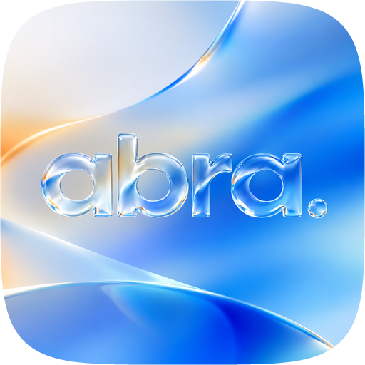
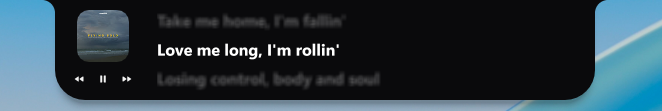

<p align="center">
  
</p>

<h1 align="center">ABRA</h1>

> [!WARNING]
> **Early Access.** ABRA is still in active development. Things can break, look unfinished or change between versions,
> and some settings may move or reset in a later release. Please [report bugs and ideas](https://github.com/abdeealfarizi/abra/issues)
> — every report helps. ABRA 0.5 and later can update itself (*Settings → General → About*).

> [!IMPORTANT]
> **Disclaimer.** ABRA is an independent, fan‑made project. It is **not affiliated with, endorsed by or sponsored by
> Apple Inc.** in any way. ABRA uses its own names (Deck, Visor, Rail, Scene, Quick Search, Quick Panel, Crystal and so on).
> “Apple”, “macOS”, “Tahoe”, “Liquid Glass”, “Dynamic Island”, “Stage Manager”, “Mission Control”, “Spotlight”,
> “Launchpad”, “AirDrop”, “AirPlay” and related names are trademarks of Apple Inc. ABRA ships no Apple code, icons,
> fonts or other assets.

<p align="center">
  <b>A modern glass desktop for Windows 11.</b><br>
  Deck · Visor · Rail · Quick Panel · Quick Search · Scene · Widgets — native, written in Rust, about 15 MB of RAM.
</p>

<p align="center">
  <a href="https://github-release-stats.ghostbyte.dev/abdeealfarizi/abra"></a>  
  
  
  
  
  <a href="https://abdeealfarizi.github.io/abra-site/"></a>
  <a href="https://saweria.co/kreativadev"></a>
</p>

<p align="center">
  <a href="https://abdeealfarizi.github.io/abra-site/">Website</a> ·
  <a href="#-install">Install</a> ·
  <a href="#-how-to-use-each-feature">How to use</a> ·
  <a href="#-modular-turn-off-what-you-dont-want">Modular</a> ·
  <a href="#-privacy">Privacy</a> ·
  <a href="#-built-with">Built with</a> ·
  <a href="#-build-from-source">Build</a> ·
  <a href="#-support-abra">Support</a>
</p>

---

## ✨ What is ABRA?

ABRA turns Windows 11 into a clean, modern desktop:

- a magnifying **Deck** for your apps,
- a **Visor** at the top of the screen that shows what is going on (music with live lyrics, downloads, timers, files),
- a **Rail** with real app menus, Wi‑Fi and battery,
- a **Quick Panel** for toggles and sliders, **Quick Search**, **Scene**, **Overview** and desktop **Widgets**,

all drawn with a frosted glass material and springy animations.

It is one small native program: no Electron, no web view, no background services, no account. At idle it uses about
**15 MB** of private memory.

<p align="center">
  
</p>

### 🆕 New in 0.6.1

- **Español**: ABRA now speaks Spanish (*Settings → General → Language*). The whole interface is translated, including
  dates, the calendar, Focus sessions, tasks, the Rail app menus and the Send to phone page. Thanks to
  [itssebxs](https://github.com/itssebxs) for this community contribution!
- The Visor size slider is now labelled **Visor size**, so it no longer shares its name with the Deck's size group.
- Other apps' own menus in the Rail are shown exactly as the app provides them, in every language.

### 0.6.0

- **More than one screen**: choose where the Deck, Rail, Visor and desktop widgets appear (*Main*, *Screen 1*, *Screen 2*…)
  under **Show on** in each page of Settings. Unplug a screen and everything moves to the main one; plug it back in and
  it returns. Mixed scaling (for example 100% and 150%) is handled per screen.
- **Presets**: one click restyles the Deck, Rail and Visor together — *Default*, *Prism* (bright glass), *Neon* (black with
  a glowing edge), *Aurora* (soft violet glass), *Stealth* (pure black, minimal) and *Pixel* (retro, square corners,
  monospace). *Settings → Appearance → Preset*; you can still fine‑tune everything afterwards.
- **Music visualizer styles** in the Visor: *Bars*, a 16‑band *Spectrum*, *Wave* and *Dots* (*Settings → Visor*).
- **Focus sessions** in the Visor: pick *Work*, *Study*, *Reading* or your own named session, each with its own focus and
  break length; four rounds with automatic breaks, a pill when each part ends, sessions that survive a restart, and a
  *Today* card with your focus minutes and the last 7 days.
- **Clipboard stack** in Quick Search: images (with thumbnails) and colour codes next to text, and **pins** for things you
  keep pasting. Only pinned items are saved to disk.
- **Quick actions**: drop files on the new *Quick actions* zone of the Visor to shrink images by half, convert them to JPG
  or PNG, or zip anything, saved next to the originals. Quick Search adds *Make a QR code from the clipboard* and *Pick a
  colour from the screen*.
- **Meeting companion**: ten minutes before a meeting in your Windows Calendar the Visor shows a countdown and a **Join**
  button when the event has a Meet, Zoom or Teams link; during the meeting it shows the time and whether your mic or
  camera is on.
- **Capsule modules**: choose what the idle Visor and Capsule show (greeting, clock, date, battery, CPU and RAM, Wi‑Fi
  network and your next calendar event), put them in any order, and show them one at a time or **side by side** (the
  first module stays on the left while the others take turns on the right). Add an accent dot or a soft edge glow
  (*Settings → Visor → Capsule modules*).
- **Community themes**: share your look as a small `.abratheme` text file and apply themes from others in one click
  (*Settings → Appearance → Community themes*). A theme can only set appearance options (preset, accent colour, font,
  visualizer, transparency, corners, glow, motion, decoration and Capsule modules). Every file is checked first: unknown
  keys are ignored and named, numbers are kept in range, and nothing in a theme is ever run, opened or downloaded.
- **Sturdier on more PCs**: Quick Search and Settings open on the screen your mouse is on, window animations work on
  every screen, external monitors get real brightness through DDC/CI (or software dimming on each screen), the Visor fits
  narrow portrait screens, YouTube thumbnails are no longer squashed into the album square, files on slow network
  drives no longer freeze the Visor shelf, and ABRA recovers by itself when the graphics driver resets or a laptop
  switches GPUs.
- **Smart Deck reacts right away**: when you switch to another app the Deck now hides at once, even while other
  windows keep popping up in the background.
- **Volume keys**: the volume up, down and mute keys now show only ABRA's glass HUD; the Windows volume bar no longer
  pops up on top of it.
- **Sensitivity**: choose *Quick* or *Relaxed* for the Deck, Rail and Visor. *Relaxed* waits about half a second at the
  screen edge, so they no longer pop up when the mouse just passes by; *Quick* also opens the Visor faster.
- **Fonts**: Inter, Segoe UI, Bahnschrift or a monospace font, applied after a one‑click restart, plus **Reduce motion**
  to keep the visualizer, Aurora light and Visor morph still (*Settings → Appearance → Text and motion*).

<p align="center">
  
  
</p>
<p align="center">
  
</p>
<p align="center">
  
  
</p>
<p align="center">
  
</p>

### 0.5.0

- **Built‑in updates**: ABRA checks GitHub for a new release, shows it in the Visor and installs it with one click
  (*Settings → General → About*). The installer is checked against its SHA‑256 fingerprint before it runs.
- **Tasks & reminders**: press `Ctrl` + `Alt` + `N` (or **Add a task** in the Visor), type `15:30 meeting`,
  `10m stretch` or `tomorrow 08:00 report` right in the Visor and press Enter. The new **Tasks** page lists them, and
  reminders pop up in the Visor when they are due.
- **Visor pills**: short notices when Bluetooth earbuds, a mouse or a USB drive connects or disconnects.
- **Aurora**: while music plays, soft waves of light in the colours of the album art move along the bottom of the Visor
  and Capsule and rise with the bass, mids and treble — the Visor now has real depth.
- **A fresh look for the open Visor**: a two‑tone page title, the date and time in the middle, page dots instead of tabs,
  a colour for every page and no more grey boxes.
- **Visor & Capsule**: adjustable **size**, adjustable **distance from the top edge** for the Capsule, and a springy
  “water drop” animation when switching between them. **Send** now has a **Cancel** button.
- **Rail**: a **behaviour** setting like the Deck’s (Fixed · Overlay · Smart), **menus that match the app**
  (browsers, File Explorer, Office, code editors, Spotify), *About* opens the app’s own details, *Help → ABRA Guide*
  opens the guide, and Store apps show their real names.
- **Fullscreen**: the Rail, Visor and Deck now hide during fullscreen videos and games.
- **Fixes**: the Windows taskbar stays hidden after a restart, maximized apps no longer get an extra gap under the Rail,
  the Smart Visor reappears at the top edge reliably, and the Visor follows the app that is actually playing music.
- **Fixes from your reports**:
  - ABRA starts right after sign‑in instead of minutes later;
  - no more cursor stutter or freezes from ABRA’s input hooks;
  - brightness works on laptops where Windows can’t set it, using a gentle software dimmer instead;
  - Task Manager, Calculator and Notepad open again from ABRA;
  - smoother minimize and restore animations;
  - the Clock widget category shows a clock;
  - Settings closes with ✕ or `Esc`;
  - the tray icon opens Settings with a left click;
  - Quick Panel sliders follow the pointer all the way to both ends;
  - Settings → Appearance explains why the Deck looks solid when Windows transparency or battery saver is on.

<details>
<summary><b>In 0.4.1</b></summary>

- **New look out of the box**: a fresh install now starts with the Rail, Visor and Deck together, with an auto‑hiding
  Deck. Settings you already changed are kept.
- **Fixes**: the Visor battery percentage keeps updating instead of freezing after the first reading, and the Wi‑Fi and
  Bluetooth controls in the Quick Panel open their menus again instead of closing straight away.
</details>

<details>
<summary><b>In 0.4.0</b></summary>

- **Desktop widgets**: Clock, World Clock, Today, Month, Digital Clock, Battery and System Monitor, in the **Original** or
  **Crystal** material. Add them from a widget gallery; they snap to a tidy grid with a placeholder while you drag.
- **Capsule**: an optional floating, pill‑shaped Visor.
- **Global scale** (100 · 125 · 150%) for the Deck, Visor, Rail and Quick Panel.
- **Quick Panel editing**: drag controls to rearrange them (neighbours slide out of the way) and drag the glass corner
  handle to resize any control — Wi‑Fi down to a single circle, sliders vertical or wide, Playing from a play button up
  to a large card.
- **Wi‑Fi**: connect to your saved networks without location access, live signal strength, and new Wi‑Fi and battery icons
  in the Rail with the battery percentage inside, outside or hidden.
- **Windows** open and close with an animation; Scene cards fly in from where they sit.
- **Settings** redesigned with a floating glass sidebar, and your own image as the Rail logo.
- **Own names** for every part: Deck, Visor, Rail, Scene, Quick Search, Quick Panel, Overview and App Grid.
- **Fixes**: Deck pins survive app updates (Microsoft Store and auto‑updating apps), closed apps can be removed from the
  Deck, opening apps no longer freezes ABRA, the Visor and Deck always stay above other windows, and text can no longer be
  garbled by third‑party fonts.
- **Lighter**: about a third of the memory of the previous development build.
</details>

<details>
<summary><b>In 0.3.0</b></summary>

- A brand‑new Visor with **Play**, **Shelf** and **Timer** tabs, live lyrics, a music idle mode and download progress.
- **Send to phone**: drop files on the Visor and scan a QR code with any Android or iPhone.
- Wi‑Fi and Bluetooth pickers, the ABRA app icon and a **Buy me a coffee** button.
</details>

---

## 🧩 Modular: turn off what you don’t want

Every part of ABRA is independent. Keep only the pieces you like:

| Part | Where to turn it off |
|---|---|
| Deck | *Settings → Deck → Enable Deck* |
| Visor | *Settings → Visor → Enable Visor* |
| Rail | *Settings → Rail → Enable Rail* |
| Widgets | Right‑click a widget → *Remove Widget* |
| Scene | *Settings → Scene*, or the Quick Panel control |
| Screen Corners | *Settings → Screen Corners* (set each corner to “None”) |
| Windows taskbar | *Settings → General → Hide the Windows taskbar* (turn off to keep your taskbar) |
| Window animations | *Settings → General → Window animations* |
| Recent apps in the Deck | *Settings → Deck → Recent apps* |

Use only the Deck with your normal taskbar, only the Visor, only the Rail — any mix works.

---

## 🚀 Install

> Requires **Windows 11** (build 22000 or newer), 64‑bit.

Download from the **[Releases](https://github.com/abdeealfarizi/abra/releases)** page, or from the **[ABRA website](https://abdeealfarizi.github.io/abra-site/)**, which always links to the latest version:

| File | Best for |
|---|---|
| `ABRA-Setup-0.6.1.exe` | Most people. Per‑user install, **no administrator rights**, optional Start menu shortcut and “launch at sign‑in”, clean uninstall from *Windows Settings → Apps*. |
| `ABRA-0.6.1-win-x64.zip` | Portable. Extract anywhere and keep `abra.exe`, `abra-guard.exe` and the `fonts` folder **together**. |

### Installer

1. Run `ABRA-Setup-0.6.1.exe`.
2. Windows SmartScreen may warn about an unsigned app: choose **More info → Run anyway** (only for files from this repository).
3. Pick the options you want (Start menu shortcut, launch at sign‑in) and finish. ABRA starts.

### “My antivirus says it’s a virus”

Some antivirus engines flag ABRA (for example on VirusTotal). It’s a **false positive**: ABRA is unsigned, new, and does
things that look unusual to a heuristic scanner, because a desktop shell has to do them — hiding the taskbar, a keyboard hook for
Alt+Tab, moving other apps’ windows, and starting at sign‑in. There is no telemetry and the full source is in this repository.

To make sure your copy is the real one:

1. Download only from the **[Releases](https://github.com/abdeealfarizi/abra/releases)** page of this repository.
2. In PowerShell run `Get-FileHash .\ABRA-Setup-0.6.1.exe -Algorithm SHA256` and compare the result with the
   **sha256** shown next to the file on the Releases page. They must match exactly.
3. If you prefer, build ABRA yourself from source (see below).

If Windows Defender quarantines the file, you can restore it from *Windows Security → Virus & threat protection →
Protection history*, but only after the fingerprint check above matches.

### Portable

1. Extract the zip to a folder you keep, for example `Documents\ABRA`.
2. Double‑click `abra.exe`.

### First run

- The Windows taskbar hides and the Rail, Visor and Deck appear. The Deck hides itself until you move the pointer to the
  bottom of the screen (turn the takeover off in *Settings → General* if you prefer your taskbar).
- Open **Settings**: right‑click the Deck → **ABRA Settings…**, or click the logo in the Rail.
- Language: *Settings → General → Language* (**English**, **Indonesia** or **Español**).

### Updating from an older version

Install 0.6.1 over the old version. Your settings, pinned apps and Quick Panel layout are kept. From 0.5.0 on, ABRA
offers new versions itself.

### Quit and uninstall

- **Quit**: right‑click an empty part of the Deck (or the Start icon) → **Quit ABRA**. The taskbar comes back automatically.
  If ABRA is ever killed, `abra-guard.exe` restores the taskbar and any windows it moved.
- **Uninstall**: *Windows Settings → Apps → Installed apps → ABRA → Uninstall* (installer), or quit ABRA and delete the folder
  (portable). Your settings are in `%APPDATA%\ABRA`; delete that folder too for a clean removal.

---

## 📖 How to use each feature

<details open>
<summary><b>🎛 Deck</b></summary>

- **Open / switch apps**: click an icon. Running apps have a dot. Hover to magnify; hover a running app for live window previews.
- **Keep / remove**: right‑click an app → *Keep in Deck* / *Remove from Deck*. Drag icons to reorder.
- **Recent apps** you closed appear on the right; right‑click → *Remove from Deck*, or turn them off in *Settings → Deck*.
- **Close an app**: right‑click it → **Close**. **Quit ABRA** appears when you right‑click an empty area or the Start icon.
- **Minimize** a window and it flies into the Deck with a **Funnel** (or **Scale**) effect.
- **App Grid** button, a **Downloads** stack and a glass **Trash** (right‑click → *Empty Trash*).
- **Custom icons**: right‑click an app → *Change icon…*.
- **Size, magnification, behaviour (Fixed · Overlay · Smart)**: *Settings → Deck*.
</details>

<details open>
<summary><b>🕳 Visor</b></summary>

The glass pill at the top center of the screen. Choose **Visor** (attached to the top edge) or **Capsule** (floating) in
*Settings → Visor → Shape*.

<p align="center">
  
</p>

- **Hover** to peek, **rest the cursor ~0.3 s** (or click) to open the panel. Scroll the mouse wheel to switch tabs.
- **When idle**: a greeting with the time, date and battery; **music & lyrics** while a song is loaded; or just the pill.

<p align="center">
  
  
</p>

- **Play tab**: song card (artwork, title, seekable progress, controls) and big **lyrics** that scroll with the song.
  Put your own `Artist - Title.lrc` files in `%APPDATA%\ABRA\lyrics`, or let ABRA look them up on [LRCLIB](https://lrclib.net).

<p align="center">
  
</p>

- **Downloads**: Microsoft Store, Steam and browser downloads with a progress ring.
- **Shelf tab**: drag files onto the Visor and drop them on **Keep on Shelf** · **Send** · **Copy to…** · **Open with…**.

<p align="center">
  
</p>

- **Send to phone (Android & iPhone, no app)**: drop files on **Send**, scan the QR code with your phone’s camera and tap
  **Download**. Both devices must be on the **same Wi‑Fi**; allow ABRA on **Private networks** if Windows Firewall asks.

<p align="center">
  
</p>

- **Timer tab**: a timer next to a calendar strip with your Windows calendar events.
- **Tasks page**: your to‑do list with a big done counter. Click a task to tick it off. **Add a task** (or `Ctrl` + `Alt`
  + `N`) turns into a text field right in the Visor: type, press Enter to add (and keep typing the next one), Esc to
  close. A time at the start makes it a reminder: `15:30 …`, `10m …` / `2h …`, `tomorrow 08:00 …`; the Visor shows the
  time it understood as you type.
- **Pages**: switch with the dots at the bottom or the mouse wheel. Each page has its own colour.
- **Pills**: reminders, available updates and connected devices appear briefly in the Visor. Click a pill to act on it,
  right‑click to dismiss it. Choose which ones you want in *Settings → Visor → Pills & Context*.
- **Size and Capsule distance**: *Settings → Visor → Visor size* and *Distance from top edge*.
</details>

<details open>
<summary><b>📋 Rail</b></summary>

- **Logo menu**: About this PC, System Settings, Microsoft Store, ABRA Settings, App Grid, Overview, Force Quit, Sleep,
  Restart, Shut Down, Lock Screen. Use your own image as the logo in *Settings → Rail → Rail logo*.
- **App name and menus**: the active app’s real menus (File, Edit…) when it has classic menus; otherwise menus made for
  the app — tabs and bookmarks in browsers, new folder and view modes in File Explorer, formatting in Office, the command
  palette in code editors. *About* opens the app’s details and *Help → ABRA Guide* opens this guide.
- **Behaviour**: Fixed (windows stay below the Rail), Overlay, or Smart (hides under maximized windows and comes back
  when you touch the top edge) in *Settings → Rail*.
- **Right side**: battery, **Wi‑Fi**, Quick Search, Quick Panel and the clock. The Wi‑Fi icon shows live signal strength;
  the battery percentage can sit inside the icon, next to it, or be hidden (*Settings → Rail*).
- **Background**: transparent (with a soft shade), light, dark or the glass material.


- **Wi‑Fi menu**: a switch, your **saved networks** (click one to connect) and live signal strength for the current one.
  Windows only lists *nearby* networks to apps when **Location** is allowed; ABRA asks with a button and never reads or
  stores your location.

</details>

<details open>
<summary><b>🎚 Quick Panel</b></summary>

- Click the two‑switch icon in the Rail.
- **Wi‑Fi / Bluetooth**: click the round icon to switch on/off; click the rest to open the network / device picker.
  Bluetooth **headphones and speakers connect with one click**.
- **Display / Sound sliders**, a **sound output** button, Playing, Dark Mode, Scene, Overview, Screenshot and more.

<p align="center">
  
</p>

- **Edit Controls…**:
  - remove a control with **−**,
  - **drag** a control to a new place — the others slide out of the way,
  - **drag the glass corner handle** horizontally, vertically or diagonally to resize it,
  - add more from the searchable gallery.

<p align="center">
  
</p>
</details>

<details open>
<summary><b>🧱 Widgets</b></summary>

- Open the gallery from *Settings → Widgets → Add widgets*, or right‑click a widget → *Edit Widgets…*.
- **Click** a widget in the gallery to add it, or **drag** it onto the desktop; a placeholder shows the grid slot it will snap to.
- Drag widgets to move them, click one to open the matching app, right‑click → *Remove Widget*.
- Material: **Original** (solid light and dark cards) or **Crystal** (glass), in *Settings → Widgets*.
- Widgets only show the time, your calendar date, battery and CPU/memory usage. They read no personal data.

<p align="center">
  
  
</p>
</details>

<details>
<summary><b>🔍 Quick Search</b></summary>

- `Ctrl` + `Space` opens it. Type to search **Apps**, **Files**, **Actions** and **Clipboard** (switch with `Ctrl` + `1`…`4`).
- Built‑in calculator, recent files with thumbnails, file‑type filters and “Show more”.
- **Actions**: your own quick keys (*Settings → Quick Search*). **Clipboard history** is optional and kept in memory only.

<p align="center">
  
</p>
</details>

<details>
<summary><b>🎬 Scene</b></summary>

- Turn it on from the Quick Panel or *Settings → Scene*.
- Other windows become **live, tilted cards** in a side strip; click one to fly it back to the stage, Shift‑click to group.
- Click the wallpaper to tuck everything away. `Alt` + `Tab` shows ABRA’s switcher while it is on.

</details>

<details>
<summary><b>🪟 Overview, App Grid, Screen Corners, HUD</b></summary>

- **Overview** (`Ctrl` + `↑`): every window and your virtual desktops at a glance.
- **App Grid** (`Ctrl` + `Shift` + `Space` or the Deck button): a full‑screen grid of installed apps.
- **Screen Corners**: move the pointer into a screen corner to run an action.
- **Volume & brightness HUD**: a glass card with your output device name.

<p align="center">
  
</p>
</details>

<details>
<summary><b>🎨 Appearance & ⚙️ Settings</b></summary>

- *Settings → Appearance*: Auto · Light · Dark, accent color, icon style (Default · Dark · Clear · Tinted), the glass
  material (**Blur**, **Crystal** or **Black**), a separate Visor material, blur, transparency, the **scale** of the Deck,
  Visor, Rail and Quick Panel, and an optional **icon pack** (`%APPDATA%\ABRA\iconpack`, nothing is bundled).
- Settings has a floating glass sidebar with search, back / forward buttons, English and Indonesian.
- **Quick shortcuts**: `` Alt+` `` cycles windows of the same app, `Ctrl+Alt+H` hides, `Ctrl+Alt+M` minimizes,
  `Ctrl+Alt+Q` quits the active app (*Settings → General*).

<p align="center">
  
</p>
</details>

### Keyboard shortcuts

| Shortcut | Action |
|---|---|
| `Ctrl` + `Space` | Quick Search |
| `Ctrl` + `Shift` + `Space` | App Grid |
| `Ctrl` + `1` … `4` | Inside Quick Search: Apps · Files · Actions · Clipboard |
| `Ctrl` + `Alt` + `N` | Add a task or reminder |
| `Ctrl` + `↑` | Overview |
| `Alt` + `Tab` | ABRA window switcher (while Scene is on) |
| `Esc` | Close the active overlay |

The complete guide in Indonesian is in [`docs/PANDUAN.md`](docs/PANDUAN.md).

---

## 🔒 Privacy

**ABRA does not collect, store or send any data about you.** There is no telemetry, no analytics, no account and no ads.
Everything ABRA knows stays on your PC, in `%APPDATA%\ABRA`.

- **Lyrics**: if a song has no local `.lrc` file, ABRA asks [LRCLIB](https://lrclib.net) using only the title, artist,
  album and length. You can turn it off (*Settings → Visor*).
- **Update check**: about once every 12 hours ABRA reads the public list of releases from `api.github.com`. Nothing about
  you is sent. Turn it off in *Settings → General → About*. Updates are only downloaded when you click **Update**.
- **Tasks** are stored on your PC in `%APPDATA%\ABRA\todo.txt`.
- **Send to phone** runs a tiny temporary web server on your **local network only**, under a random link, serving only the files
  you dropped. It stops when you click Cancel, after 15 idle minutes, or when ABRA quits.
- **Read‑only, on demand**: saved Wi‑Fi network names and signal strength, Bluetooth devices, calendar events, download
  progress (file names and sizes only), and which apps use the microphone / camera. ABRA never reads your location.
- **Clipboard history** is optional, text only, kept in memory for 8 hours and never written to disk.
- A keyboard hook is used **only** to catch `Alt+Tab` while Scene is on. Keystrokes are never logged or sent.
- Release builds are checked so that they contain no paths or user names from the developer’s PC.

---

## 🛠 Built with

- **[Rust](https://www.rust-lang.org)** — the whole app, in five crates.
- **[windows‑rs](https://github.com/microsoft/windows-rs)** — direct access to Win32 and WinRT APIs.
- **Windows.UI.Composition** — GPU‑composited visuals, springs and blur for the glass materials and all animations, with
  one shared graphics device for the whole app.
- **Win32 / WinRT platform APIs** — WASAPI, System Media Transport Controls, WLAN, Bluetooth, network information, WIC,
  GDI text rendering, OLE drag and drop.
- **[Inno Setup](https://jrsoftware.org/isinfo.php)** — the installer.
- Bundled font: **[Inter](https://rsms.me/inter/)** (SIL Open Font License), with Segoe UI Variable as the fallback.
  ABRA never uses fonts you installed yourself, so a broken third‑party font can’t garble its text.

No Electron, no web view, no .NET runtime. Self‑written pieces include the QR‑code encoder, the LRC lyrics parser and the
small HTTP server for *Send to phone*.

---

## 🛠 Build from source

<details>
<summary><b>Step by step</b></summary>

### 1. Install the toolchain

1. Install **Rust** with [rustup](https://rustup.rs) and select the MSVC toolchain:
   ```powershell
   rustup default stable-x86_64-pc-windows-msvc
   ```
2. Install **Visual Studio Build Tools** with the workload **Desktop development with C++** (includes `link.exe` and the Windows 11 SDK).
3. Install **Git**.

### 2. Clone and build

```powershell
git clone https://github.com/abdeealfarizi/abra.git
cd abra
cargo build --release
.\target\release\abra.exe
```

You get `abra.exe` and `abra-guard.exe` in `target\release\`.

> **“link.exe not found”?** Install the C++ workload above, or create a local `.cargo\config.toml` that points Cargo at `rust-lld`
> and your MSVC / Windows SDK library folders. `.cargo/` is git‑ignored because it holds machine‑specific paths.

### 3. Tests and release build

```powershell
cargo test --workspace

winget install JRSoftware.InnoSetup                            # once
powershell -File installer\build-installer.ps1 -Version 0.6.1
```

The release script rebuilds ABRA with local paths stripped, **refuses to continue** if a binary still contains your user
name or a local path, and writes `dist\ABRA-Setup-0.6.1.exe` and `dist\ABRA-0.6.1-win-x64.zip`.

### 4. Safe experiments

Run an **isolated** instance that does not touch your real settings:

```powershell
$env:NACRE_CONFIG_DIR = "$PWD\target\cfg-test"
.\target\release\abra.exe --keep-taskbar --exit-after 30
```

Useful flags: `--keep-taskbar`, `--no-dock`, `--no-island`, `--no-hud`, `--open-settings`, `--open-widgets`,
`--exit-after <seconds>`, `--add-app <path>`, `--set-icon <app|start|launchpad> <image>`.

> With Scene on, ABRA moves your real windows. Let a test instance exit normally (`--exit-after`) instead of killing it.

Testing several screens on one display: set `NACRE_FAKE_MONITORS_FILE` to a text file such as
`0,0,960,1080;960,0,960,1080@144` (each screen is `x,y,width,height`, optional `@dpi`, the first one is the main screen).
ABRA splits your display into those screens and re‑reads the file every second, so editing it simulates plugging or
unplugging a screen.

</details>

### Project layout

| Path | Contents |
|---|---|
| `crates/core` | Pure, unit‑tested logic: Visor state, lyrics, QR codes, Deck layout, widgets, settings, i18n, icons |
| `crates/platform` | Win32 / WinRT wrappers: windows, media, audio, Wi‑Fi, Bluetooth, downloads, icons, text, local send server |
| `crates/ui` | The glass materials on `Windows.UI.Composition`, the shared graphics device and live window capture |
| `crates/app` | The `abra` app: Deck, Visor, Rail, Quick Panel, Quick Search, Scene, Widgets, Settings |
| `crates/guard` | `abra-guard`, the watchdog that restores the taskbar and moved windows |
| `docs/` · `installer/` · `tools/` | Indonesian user guide, installer and release script, taskbar safety test |

Internal crates are named `nacre-*` (the former codename), and some internal names (settings keys, window classes, flags such
as `--no-dock`) keep their original words so existing settings keep working.

---

## ⚙️ Configuration & troubleshooting

Settings live in `%APPDATA%\ABRA\settings.cfg` (plain `key=value`), next to `pins.txt` (Deck), `icons.txt` (custom icons),
`cc_layout.txt` (Quick Panel), `widgets.txt` (widget positions), `actions.txt` (Quick Search quick keys),
`stage_exclude.txt`, `lyrics\` and `abra.log`. Set `NACRE_CONFIG_DIR` to use another folder.

- **Taskbar missing after a crash** — start `abra.exe` and quit normally, or let `abra-guard.exe` do it.
- **A window seems to have vanished** — Scene parked it. Start ABRA again; it restores parked windows.
- **Phone can’t open the Send link** — same Wi‑Fi on both? Allow ABRA in Windows Firewall for Private networks.
- **Wi‑Fi menu shows only saved networks** — Windows needs *Location* allowed before apps can see nearby networks.
- **A hotkey does nothing** — another program owns the shortcut (see `abra.log`).

**Known limitations**: dragging a Scene card onto the stage isn’t implemented (Shift‑click to group); Focus, Hotspot,
Nearby Sharing and Airplane mode open the matching Windows Settings page; only Bluetooth audio devices connect from the menu;
*Send to phone* sends files, not folders; the World Clock uses fixed time zones without daylight saving; multi‑screen support is new and
has been tested with simulated screens, so please report how it behaves on your setup.

---

## 📄 License

[PolyForm Noncommercial License 1.0.0](LICENSE.md). You may use, study, modify and share ABRA for **noncommercial** purposes;
commercial use needs written permission from the copyright holder. This is a *source‑available* license, not an OSI‑approved open
source license. The bundled **Inter** font is © The Inter Project Authors, under the SIL Open Font License 1.1
(`assets/fonts/Inter-LICENSE.txt`).

Required Notice: Copyright (c) 2026 Abdee Alfarizi

---

## ☕ Support ABRA

ABRA is free and built in spare time by **[kreativa.dev](https://saweria.co/kreativadev)**. If it makes your desktop nicer,
you can buy me a coffee — it keeps the project going. Terima kasih! 🙏

<p align="center">
  <a href="https://saweria.co/kreativadev">
    
  </a>
</p>
