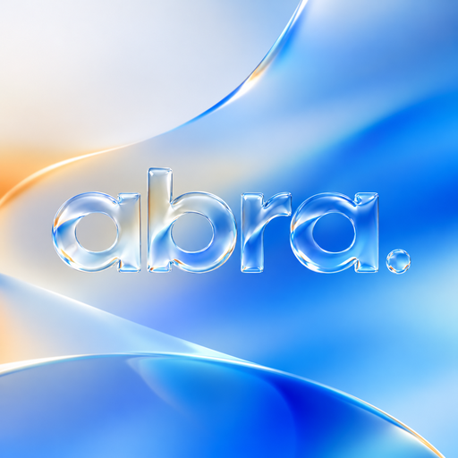

<p align="center">
  
</p>

<h1 align="center">ABRA</h1>

<p align="center">
  <b>A macOS Tahoe–style “Liquid Glass” desktop for Windows 11.</b><br>
  Dock · Notch · Menu Bar · Spotlight · Stage Manager · Control Center — in Rust, light on RAM and CPU.
</p>

<p align="center">
  
  
  
  
  
</p>

<!--
  SCREENSHOTS — add your own images here, for example:

  <p align="center"></p>

  Suggested shots: desktop (dock + menu bar + notch), Control Center, Spotlight, Apps, Stage Manager, Settings.
-->

> ABRA is an independent project and is **not affiliated with Apple**. “macOS”, “Tahoe” and “Liquid Glass” are trademarks of
> Apple Inc. ABRA imitates behavior and look only and ships no Apple assets.

---

## ✨ What you get

| | |
|---|---|
| **🎛 Dock** | Magnification computed by the compositor (≈ 0 % CPU), window previews, uniform macOS‑style icon plates, minimize / open / close animations, drag to reorder, custom icons, an **Apps** button, a **Downloads stack**, your three most recent apps and a Recycle Bin. |
| **🕳 Notch (island)** | Now playing with artwork and a live visualizer, calendar, timer and quick controls, plus a volume / brightness HUD at the top right. |
| **📋 Menu bar** | Active app name and its native menus, Wi‑Fi / battery / clock, Spotlight and Control Center buttons. Transparent, light or dark background; text color adapts to your wallpaper. |
| **🔍 Spotlight** | One search box with four modes: **Apps**, **Files**, **Actions** (with your own quick keys) and **Clipboard**. Calculator built in. |
| **🧩 Stage Manager** | Windows outside the stage become **live, tilted cards** in a side strip: videos and animations keep playing inside them. Group windows, switch with Alt+Tab replacement, click the wallpaper to tuck everything away. |
| **🎚 Control Center** | Floating glass modules (Wi‑Fi, Bluetooth, Now Playing, Dark Mode, Focus, sliders…), an Edit mode with a searchable gallery, and resizable modules. |
| **🪟 Mission Control · Hot corners** | Live window overview with virtual desktops, and four configurable screen corners. |
| **🎨 Appearance** | Light / dark / auto theme, one global material (Liquid Glass or solid black), glass blur and transparency, icon styles **Default · Dark · Clear · Tinted**, an **accent color**, an optional **icon pack** (drop PNGs in `%APPDATA%\ABRA\iconpack`; nothing is bundled). |
| **⌨️ Mac‑style shortcuts** | `` Alt+` `` cycles windows of the same app, `Ctrl+Alt+H` hides, `Ctrl+Alt+M` minimizes, `Ctrl+Alt+Q` quits (politely) the active app. Can be turned off. |
| **⚙️ Settings** | A System‑Settings‑style window with a sidebar and grouped cards. English and Indonesian UI. |

Everything runs in one small native process. No telemetry, no network access.

---

## 🚀 Quick start

### Download

Grab one of these from the **[Releases](https://github.com/abdeealfarizi/abra/releases)** page:

| Download | Best for |
|---|---|
| `ABRA-Setup-<version>.exe` | Most people. Per‑user install, **no administrator rights**, optional Start menu shortcut and “launch at sign‑in”, clean uninstall from *Settings → Apps*. |
| `ABRA-<version>-win-x64.zip` | Portable use. Extract anywhere and keep `abra.exe` and `abra-guard.exe` **in the same folder**. |

### First run

1. Start `abra.exe`. The Windows taskbar hides and the dock appears.
2. Windows SmartScreen may warn about an unsigned app. Choose **More info → Run anyway** if you downloaded it from this repository.
3. Right‑click the dock → **ABRA Settings…** (or click the logo in the menu bar) to make it yours.
4. Optional: **Settings → General → Launch at Windows login**.

To quit: right‑click the dock (or the tray icon) → **Quit ABRA**. The taskbar comes back automatically; if ABRA is ever killed,
`abra-guard.exe` restores it for you.

> Requires **Windows 11** (build 22000 or newer), x64.

### Keyboard shortcuts

| Shortcut | Action |
|---|---|
| `Ctrl` + `Space` | Spotlight |
| `Ctrl` + `Shift` + `Space` | Apps |
| `Ctrl` + `1` … `4` | Inside Spotlight: Apps · Files · Actions · Clipboard |
| `Ctrl` + `↑` | Mission Control |
| `Alt` + `Tab` | ABRA window switcher (while Stage Manager is on) |
| `Esc` | Close the active overlay |

---

## 🔒 Privacy & safety

- **No telemetry and no network access.** The only web action is Spotlight’s “Search the web” row, which opens *your* browser
  and only if you choose it.
- **Clipboard history is optional**, text only, kept in memory for 8 hours and never written to disk or sent anywhere.
  Content flagged by password managers is skipped.
- A low‑level keyboard hook is used **only** to swallow `Alt+Tab` while the Stage Manager switcher is on. Keystrokes are never
  logged, stored or sent.
- Stage Manager moves other apps’ windows out of the way and back. If ABRA dies, `abra-guard.exe` (or your next start) puts them back.
- Your settings stay in `%APPDATA%\ABRA`.

---

## 🛠 Build from source

<details>
<summary><b>Step by step</b></summary>

### 1. Install the toolchain

1. Install **Rust** with [rustup](https://rustup.rs) and select the MSVC toolchain:
   ```powershell
   rustup default stable-x86_64-pc-windows-msvc
   ```
2. Install **Visual Studio Build Tools** with the workload **Desktop development with C++** (includes `link.exe` and the Windows 11 SDK).
3. Install **Git**.

### 2. Clone and build

```powershell
git clone https://github.com/abdeealfarizi/abra.git
cd abra
cargo build --release
.\target\release\abra.exe
```

You get `abra.exe` and `abra-guard.exe` in `target\release\`.

> **“link.exe not found”?** Install the C++ workload above, or create a local `.cargo\config.toml` that points Cargo at `rust-lld`
> and your MSVC / Windows SDK library folders. `.cargo/` is git‑ignored because it holds machine‑specific paths.

### 3. Fonts

ABRA uses **SF Pro** if you have it installed, otherwise **Inter** (bundled in `assets/fonts`, copy that folder next to
`abra.exe` as `fonts\`), otherwise Segoe UI Variable.

### 4. Tests, installer, safe experiments

```powershell
cargo test -p nacre-core -p nacre-platform                  # pure logic and platform helpers
cargo build --profile fast                                  # quicker rebuilds (no full LTO)

winget install JRSoftware.InnoSetup                         # once
powershell -File installer\build-installer.ps1 -Version 0.1.0   # → dist\ABRA-Setup-0.1.0.exe
```

Run an **isolated** instance that does not touch your real settings:

```powershell
$env:NACRE_CONFIG_DIR = "$PWD\target\cfg-test"
.\target\release\abra.exe --keep-taskbar --no-island --no-hud --exit-after 30
```

Useful flags: `--keep-taskbar`, `--no-dock`, `--no-island`, `--no-hud`, `--open-settings`, `--exit-after <seconds>`,
`--add-app <path>`, `--set-icon <app|start|launchpad> <image>`.

> With Stage Manager on, ABRA moves your real windows. Always let a test instance exit normally (`--exit-after`) instead of
> killing it; if it was killed, start ABRA once more with the same `NACRE_CONFIG_DIR` and it restores the windows.

</details>

---

## 🧭 Project layout

| Path | Contents |
|---|---|
| `crates/core` | Pure, unit‑tested logic: dock layout, settings, Stage Manager model, Spotlight model, symbols, i18n |
| `crates/platform` | Win32 / WinRT wrappers: windows, media, audio, Wi‑Fi, icons, clipboard, input hooks |
| `crates/ui` | The Liquid Glass material on `Windows.UI.Composition`, plus live window capture |
| `crates/app` | The `abra` application: dock, island, menu bar, Spotlight, Stage Manager, Control Center, settings |
| `crates/guard` | `abra-guard`, the watchdog that restores the taskbar and parked windows |
| `docs/` | The full user guide ([`PANDUAN.md`](docs/PANDUAN.md), Indonesian) |
| `installer/` · `tools/` | Inno Setup installer and the taskbar/guard regression script |

Internal crates are named `nacre-*` (the project’s former codename); the app and binaries are `abra`. Many source comments are in Indonesian.

---

## ⚙️ Configuration

Settings live in `%APPDATA%\ABRA\settings.cfg` (plain `key=value`). Next to it:

| File | Purpose |
|---|---|
| `pins.txt` | Pinned dock apps |
| `icons.txt` | Custom icons |
| `cc_layout.txt` | Control Center layout and module sizes |
| `actions.txt` | Your Spotlight quick keys |
| `stage_exclude.txt` | Programs Stage Manager must never move (one name or path fragment per line) |
| `abra.log` | Log, handy for bug reports |

Set `NACRE_CONFIG_DIR` to use another folder.

---

## ❓ Troubleshooting

- **Taskbar missing after a crash** — start `abra.exe` and quit normally, or let `abra-guard.exe` do it.
- **A window seems to have vanished** — Stage Manager parked it. Start ABRA again; it restores parked windows on launch.
- **A hotkey does nothing** — another program owns the same shortcut (see `abra.log`).
- **An app won’t join Stage Manager** — apps running as Administrator can’t be moved by a normal process, so ABRA leaves them alone.
- **Cursor still round after ABRA died** — run ABRA once and quit normally, or turn it off in Windows *Mouse pointer* settings.

## 📝 Known limitations

- Dragging a Stage Manager card onto the stage is not implemented (use Shift‑click to group).
- Focus, Hotspot, Nearby Sharing and Airplane mode only open the matching Windows Settings page.
- Menus that apps fill lazily (for example recent files) don’t appear in the menu bar.
- Tested on Windows 11 with a single primary display.

## 🤝 Contributing

Issues and pull requests are welcome. Please run `cargo test -p nacre-core -p nacre-platform` first and attach a screenshot for UI changes.

## 📄 License

[PolyForm Noncommercial License 1.0.0](LICENSE.md). You may use, study, modify and share ABRA for **noncommercial** purposes;
commercial use needs written permission from the copyright holder. This is a *source‑available* license, not an OSI‑approved open
source license.

The bundled **Inter** font is © The Inter Project Authors, under the SIL Open Font License 1.1 (see `assets/fonts/Inter-LICENSE.txt`).

Required Notice: Copyright (c) 2026 Abdee Alfarizi
