<p align="center">
  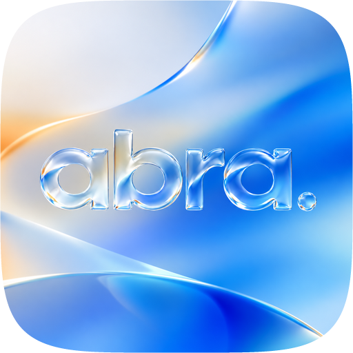
</p>

<h1 align="center">ABRA</h1>

> [!IMPORTANT]
> **Disclaimer.** ABRA is an independent, fan‑made project. It is **not affiliated with, endorsed by or sponsored by
> Apple Inc.** in any way. It is only *inspired by* the look and feel of macOS. “Apple”, “macOS”, “Tahoe”, “Liquid Glass”,
> “AirDrop” and related names are trademarks of Apple Inc. ABRA ships no Apple code, icons, fonts or other assets.

<p align="center">
  <b>A macOS‑inspired “Liquid Glass” desktop for Windows 11.</b><br>
  Dock · Notch · Menu Bar · Spotlight · Stage Manager · Control Center — native, written in Rust, light on RAM and CPU.
</p>

<p align="center">
  
  
  
  
  <a href="https://saweria.co/kreativadev"></a>
</p>

<p align="center">
  <a href="#-install">Install</a> ·
  <a href="#-how-to-use-each-feature">How to use</a> ·
  <a href="#-modular-turn-off-what-you-dont-want">Modular</a> ·
  <a href="#-privacy">Privacy</a> ·
  <a href="#-built-with">Built with</a> ·
  <a href="#-build-from-source">Build</a> ·
  <a href="#-support-abra">Support</a>
</p>

---

## ✨ What is ABRA?

ABRA turns Windows 11 into a desktop with the feel of macOS: a magnifying **dock**, a **notch** that shows what is going on
(music with live lyrics, downloads, timers, files), a **menu bar** with real app menus, **Spotlight**, **Stage Manager**,
**Control Center**, **Mission Control** and more, all drawn with a frosted “Liquid Glass” material.

It is one small native program. No Electron, no web view, no background services, no account.

<p align="center">
  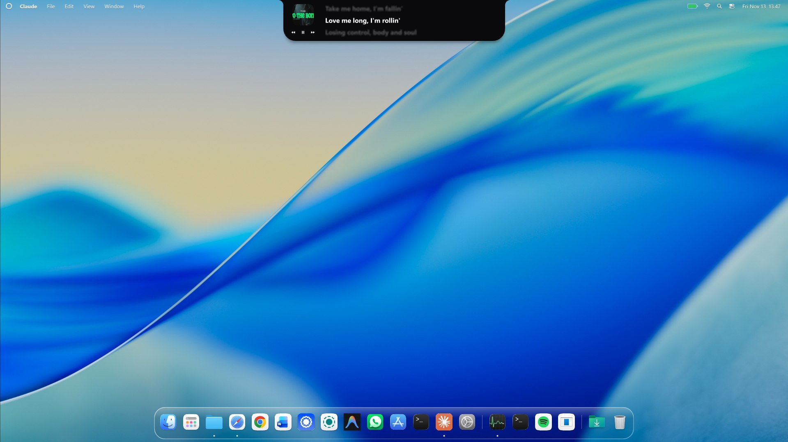
</p>

### 🆕 New in 0.3.0

- **A brand‑new notch**: hover to peek, rest to open a panel with **Play**, **Shelf** and **Timer** tabs.
- **Live lyrics** in the notch (your own `.lrc` files or the free LRCLIB service), Apple‑Music‑style.
- **Music & lyrics idle mode**: a wide notch with artwork, back · play/pause · next and lyrics.
- **Downloads in the notch**: Microsoft Store, Steam and browser downloads with a green progress ring.
- **Send to phone**: drop files on the notch, scan a QR code with any Android or iPhone, download. No app needed.
- **Timer + calendar** tab with your Windows calendar events.
- **Wi‑Fi and Bluetooth pickers** in the menu bar and Control Center; connect headphones and speakers in one click.
- ABRA app icon, a **Buy me a coffee** button in Settings, and many fixes.

---

## 🧩 Modular: turn off what you don’t want

Every part of ABRA is independent. Keep only the pieces you like:

| Part | Where to turn it off |
|---|---|
| Dock | *Settings → Dock → Enable dock* |
| Notch | *Settings → Notch → Enable notch* |
| Menu bar | *Settings → Menu Bar → Enable menu bar* |
| Stage Manager | *Settings → Stage Manager*, or the Control Center module |
| Hot corners | *Settings → Hot Corners* (set each corner to “None”) |
| Windows taskbar | *Settings → General → Hide the Windows taskbar* (turn off to keep your taskbar) |
| Notch activities | *Settings → Notch*: lyrics, downloads, “Send to phone”, idle style |
| Mac‑style shortcuts, clipboard history | *Settings → General* and *Settings → Spotlight* |

Use only the dock with your normal taskbar, only the notch, only the menu bar — any mix works.

---

## 🚀 Install

> Requires **Windows 11** (build 22000 or newer), 64‑bit.

Download from the **[Releases](https://github.com/abdeealfarizi/abra/releases)** page:

| File | Best for |
|---|---|
| `ABRA-Setup-0.3.0.exe` | Most people. Per‑user install, **no administrator rights**, optional Start menu shortcut and “launch at sign‑in”, clean uninstall from *Windows Settings → Apps*. |
| `ABRA-0.3.0-win-x64.zip` | Portable. Extract anywhere and keep `abra.exe` and `abra-guard.exe` **in the same folder**. |

### Installer

1. Run `ABRA-Setup-0.3.0.exe`.
2. Windows SmartScreen may warn about an unsigned app: choose **More info → Run anyway** (only for files from this repository).
3. Pick the options you want (Start menu shortcut, launch at sign‑in) and finish. ABRA starts.

### Portable

1. Extract the zip to a folder you keep, for example `Documents\ABRA`.
2. Double‑click `abra.exe`.

### First run

- The Windows taskbar hides and the dock appears (turn this off in *Settings → General* if you prefer your taskbar).
- Open **Settings**: right‑click the dock → **ABRA Settings…**, or click the ABRA logo in the menu bar.
- Language: *Settings → General → Language* (**English** or **Indonesia**).

### Quit and uninstall

- **Quit**: right‑click an empty part of the dock (or the Start icon, or the tray icon) → **Quit ABRA**. The taskbar comes back
  automatically. If ABRA is ever killed, `abra-guard.exe` restores the taskbar and any windows it moved.
- **Uninstall**: *Windows Settings → Apps → Installed apps → ABRA → Uninstall* (installer), or quit ABRA and delete the folder
  (portable). Your settings are in `%APPDATA%\ABRA`; delete that folder too for a clean removal.

---

## 📖 How to use each feature

<details open>
<summary><b>🎛 Dock</b></summary>

- **Open / switch apps**: click an icon. Running apps have a dot. Hover to magnify; hover a running app for live window previews.
- **Pin / unpin**: right‑click an app → *Keep in dock* / *Remove from dock*. Drag icons to reorder.
- **Close an app**: right‑click it → **Close** (bottom item). **Quit ABRA** only appears when you right‑click an empty area or the Start icon.
- **Minimize** a window and it flies into the dock with a **Genie** (or **Scale**) effect.
- **Apps** button opens a full‑screen app grid; the **Downloads** stack shows your latest downloads; the glass **Trash** fills
  with paper when the Recycle Bin has items (click to open, right‑click → *Empty Trash*).
- **Custom icons**: right‑click an app → *Change icon…*.
- **Size, magnification, auto‑hide, position**: *Settings → Dock*.
</details>

<details open>
<summary><b>🕳 Notch</b></summary>

The glass pill at the top center of the screen.

- **Hover** to peek, **rest the cursor ~0.3 s** (or click) to open the panel. Scroll the mouse wheel to switch tabs.
- **When idle** (*Settings → Notch → When the notch is idle → Show*):
  - **Greeting & info** — a greeting with your nickname, the time, date and battery, rotating slowly.
  - **Music & lyrics** — while a song is loaded, a wide notch with the artwork, **back · play/pause · next** buttons
    (click them without opening the panel) and lyrics on the right.
  - **Empty** — just the small pill.

<p align="center">
  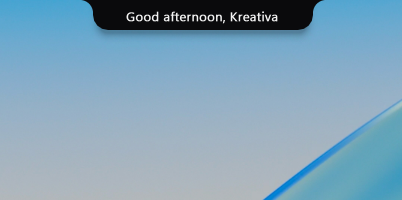
  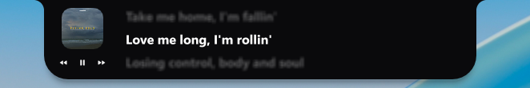
</p>

- **Activities** replace the idle view, most important first: files being dragged → a timer under 1 minute → a **download**
  → lyrics / music → charging → a running timer → files on the Shelf. An orange / green dot means an app uses the microphone / camera.
- **Play tab**: song card (artwork, title, seekable progress, controls) and big **lyrics** that scroll with the song.

<p align="center">
  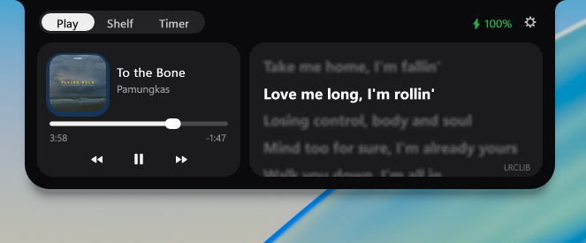
</p>

- **Lyrics**: put your own `Artist - Title.lrc` files in `%APPDATA%\ABRA\lyrics` (*Settings → Notch → Lyrics folder*), or let
  ABRA look them up on [LRCLIB](https://lrclib.net) (can be turned off).
- **Downloads**: Microsoft Store and Steam downloads show their real percentage with the store’s icon; browser downloads show
  the browser’s icon, a spinning ring and the size downloaded so far. A check mark appears when done.

<p align="center">
  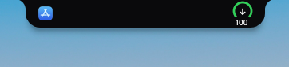
</p>

- **Shelf tab**: drag files from Explorer onto the notch and drop them on a zone:
  **Keep on Shelf** · **Send** · **Copy to…** · **Open with…**. Right‑click a Shelf item to open it, show it in its folder,
  copy its path, send it to your phone or remove it.

<p align="center">
  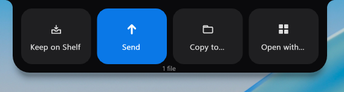
</p>

- **Send to phone (Android & iPhone, no app)**:
  1. Drop files on **Send** (or right‑click a Shelf item → *Send to phone*).
  2. The notch stays open with a **QR code**.
  3. Scan it with your phone’s camera, open the link and tap **Download**. Both devices must be on the **same Wi‑Fi**.
  4. The first time, Windows Firewall may ask about ABRA: allow it on **Private networks**.
  5. Click **Done** when finished (the session also ends after 15 idle minutes).

<p align="center">
  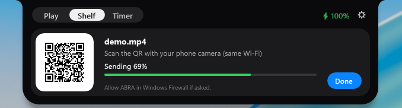
</p>

- **Timer tab**: a timer (−5 min · start/pause · reset · +5 min) next to a **calendar** strip; click a date to see its events
  from your Windows calendar.

<p align="center">
  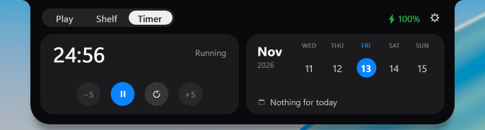
</p>
</details>

<details open>
<summary><b>📋 Menu bar</b></summary>

- **ABRA logo**: About this PC, System Settings, Microsoft Store, ABRA Settings, Apps, Mission Control, Force Quit, Sleep,
  Restart, Shut Down, Lock Screen (power actions ask first).
- **App name and menus**: the active app’s real menus (File, Edit…) when it has classic menus; standard menus that send the
  usual shortcuts otherwise. Move between open menus without clicking again.
- **Right side**: clock (Notification Center), Control Center, Spotlight, **Wi‑Fi**, battery.
- **Wi‑Fi menu**: click the Wi‑Fi icon for a switch, **Known Networks** (signal and lock icons) and **Other Networks**. Click a
  known or open network to connect.
  *On Windows 11 24H2+, Windows only lists nearby networks to apps when **Location** is on; otherwise ABRA shows a limited menu
  with a shortcut to turn Location on.*
- **Background**: transparent, light, dark or the glass material (*Settings → Menu Bar*).

<p align="center">
  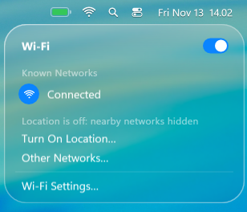
</p>
</details>

<details open>
<summary><b>🎚 Control Center</b></summary>

- Click the two‑switch icon in the menu bar.
- **Wi‑Fi / Bluetooth**: click the round icon to switch on/off; click the rest of the module (or right‑click a small module)
  to open the **network / device picker** in the top‑right corner. Bluetooth **headphones and speakers connect or disconnect
  with one click**; other devices open Windows Bluetooth settings.
- **Sound / Display sliders**, a **sound output** button (speakers, headphones), Now Playing, Dark Mode, Stage Manager,
  Mission Control, Screenshot and more.
- **Edit Controls…**: remove modules with **−**, drag to reorder, right‑click to resize, add more from the searchable gallery.

<p align="center">
  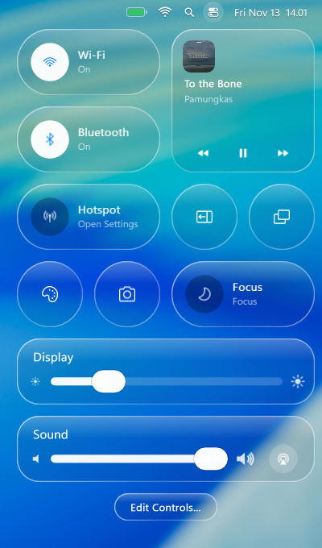
</p>
</details>

<details>
<summary><b>🔍 Spotlight</b></summary>

- `Ctrl` + `Space` opens it. Type to search **Apps**, **Files**, **Actions** and **Clipboard** (switch with `Ctrl` + `1`…`4`).
- Built‑in calculator, recent files with thumbnails, file‑type filters and “Show more”.
- **Actions**: your own quick keys (*Settings → Spotlight*). **Clipboard history** is optional and kept in memory only.

<p align="center">
  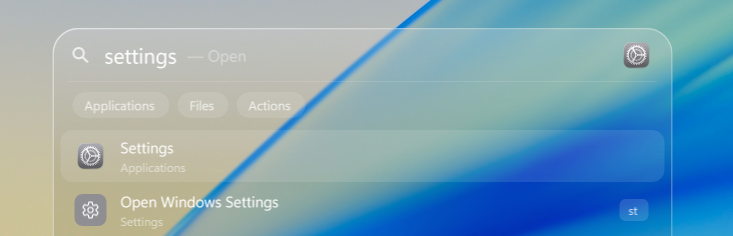
</p>
</details>

<details>
<summary><b>🧩 Stage Manager</b></summary>

- Turn it on from Control Center or *Settings → Stage Manager*.
- Other windows become **live, tilted cards** in a side strip; click one to bring it to the stage, Shift‑click to group.
- Click the wallpaper to tuck everything away. `Alt` + `Tab` shows ABRA’s switcher while it is on.
</details>

<details>
<summary><b>🪟 Mission Control, Apps, Hot corners, HUD</b></summary>

- **Mission Control** (`Ctrl` + `↑`): every window and your virtual desktops at a glance.
- **Apps** (`Ctrl` + `Shift` + `Space` or the dock button): a full‑screen grid of installed apps.
- **Hot corners** (*Settings → Hot Corners*): move the pointer into a screen corner to run an action.
- **Volume & brightness HUD**: a glass card with your output device name and a 16‑step scale.

<p align="center">
  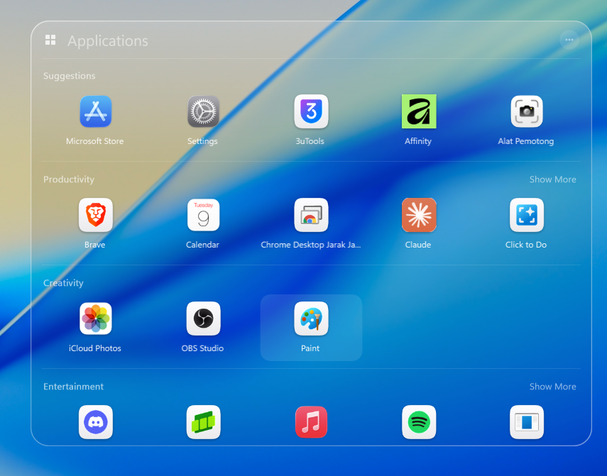
</p>
</details>

<details>
<summary><b>🎨 Appearance & ⚙️ Settings</b></summary>

- *Settings → Appearance*: Auto · Light · Dark, icon style (Default · Dark · Clear · Tinted), accent color, the glass
  material (**Blur**, **Liquid Glass** or **Black**), a separate notch material, blur and transparency, and an optional
  **icon pack** (`%APPDATA%\ABRA\iconpack`, nothing is bundled).
- Settings has search, back / forward buttons, English and Indonesian, and a **Buy me a coffee** button.
- **Mac‑style shortcuts**: `` Alt+` `` cycles windows of the same app, `Ctrl+Alt+H` hides, `Ctrl+Alt+M` minimizes,
  `Ctrl+Alt+Q` quits the active app (*Settings → General*).

<p align="center">
  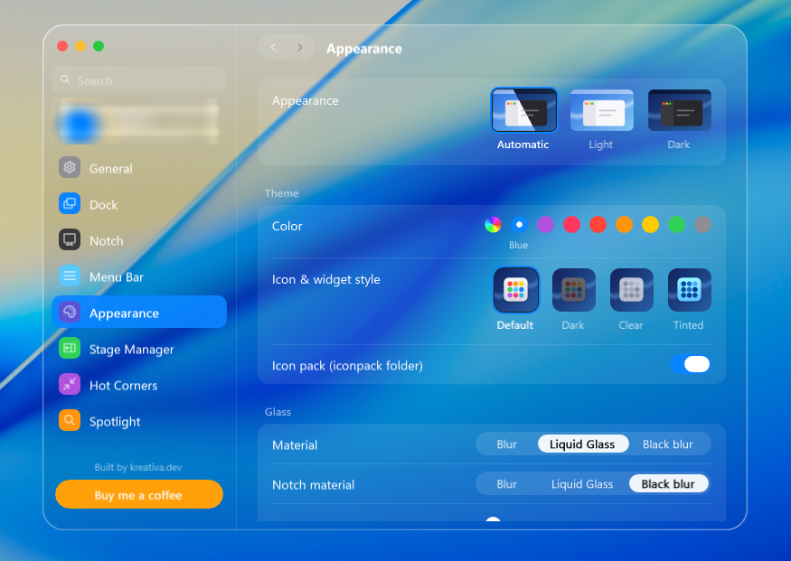
</p>
</details>

### Keyboard shortcuts

| Shortcut | Action |
|---|---|
| `Ctrl` + `Space` | Spotlight |
| `Ctrl` + `Shift` + `Space` | Apps |
| `Ctrl` + `1` … `4` | Inside Spotlight: Apps · Files · Actions · Clipboard |
| `Ctrl` + `↑` | Mission Control |
| `Alt` + `Tab` | ABRA window switcher (while Stage Manager is on) |
| `Esc` | Close the active overlay |

The complete guide in Indonesian is in [`docs/PANDUAN.md`](docs/PANDUAN.md).

---

## 🔒 Privacy

**ABRA does not collect, store or send any data about you.** There is no telemetry, no analytics, no account and no ads.
Everything ABRA knows stays on your PC, in `%APPDATA%\ABRA`.

- **Lyrics** are the only internet request ABRA makes on its own: if a song has no local `.lrc` file, ABRA asks
  [LRCLIB](https://lrclib.net) using only the title, artist, album and length. You can turn it off (*Settings → Notch → Lyrics*).
- **Send to phone** runs a tiny temporary web server on your **local network only**, under a random link, serving only the files
  you dropped. It stops when you click Done, after 15 idle minutes, or when ABRA quits.
- **Read‑only, on demand**: Wi‑Fi networks and Bluetooth devices (when you open their menus), calendar events (when the Timer tab
  is visible), download progress (file names and sizes only, never contents), and which apps use the microphone / camera
  (from Windows’ own records — ABRA never opens them).
- **Clipboard history** is optional, text only, kept in memory for 8 hours and never written to disk.
- A keyboard hook is used **only** to catch `Alt+Tab` while Stage Manager is on. Keystrokes are never logged or sent.

---

## 🛠 Built with

- **[Rust](https://www.rust-lang.org)** — the whole app, in five crates.
- **[windows‑rs](https://github.com/microsoft/windows-rs)** — direct access to Win32 and WinRT APIs.
- **Windows.UI.Composition** — GPU‑composited visuals, springs and blur for the Liquid Glass material and all animations.
- **Win32 / WinRT platform APIs** — WASAPI (audio visualizer), System Media Transport Controls (now playing), WLAN and
  Bluetooth, WIC (images), GDI text rendering, OLE drag and drop.
- **[Inno Setup](https://jrsoftware.org/isinfo.php)** — the installer.
- Bundled font: **[Inter](https://rsms.me/inter/)** (SIL Open Font License). If you have SF Pro installed, ABRA uses it.

No Electron, no web view, no .NET runtime. Self‑written pieces include the QR‑code encoder, the LRC lyrics parser and the
small HTTP server for *Send to phone*.

---

## 🛠 Build from source

<details>
<summary><b>Step by step</b></summary>

### 1. Install the toolchain

1. Install **Rust** with [rustup](https://rustup.rs) and select the MSVC toolchain:
   ```powershell
   rustup default stable-x86_64-pc-windows-msvc
   ```
2. Install **Visual Studio Build Tools** with the workload **Desktop development with C++** (includes `link.exe` and the Windows 11 SDK).
3. Install **Git**.

### 2. Clone and build

```powershell
git clone https://github.com/abdeealfarizi/abra.git
cd abra
cargo build --release
.\target\release\abra.exe
```

You get `abra.exe` and `abra-guard.exe` in `target\release\` (both carry the ABRA icon).

> **“link.exe not found”?** Install the C++ workload above, or create a local `.cargo\config.toml` that points Cargo at `rust-lld`
> and your MSVC / Windows SDK library folders. `.cargo/` is git‑ignored because it holds machine‑specific paths.

### 3. Tests and installer

```powershell
cargo test -p nacre-core -p nacre-platform                     # pure logic and platform helpers
cargo build --profile fast                                     # quicker rebuilds (no full LTO)

winget install JRSoftware.InnoSetup                            # once
powershell -File installer\build-installer.ps1 -Version 0.3.0  # → dist\ABRA-Setup-0.3.0.exe
```

### 4. Safe experiments

Run an **isolated** instance that does not touch your real settings:

```powershell
$env:NACRE_CONFIG_DIR = "$PWD\target\cfg-test"
.\target\release\abra.exe --keep-taskbar --no-island --no-hud --exit-after 30
```

Useful flags: `--keep-taskbar`, `--no-dock`, `--no-island`, `--no-hud`, `--open-settings`, `--exit-after <seconds>`,
`--add-app <path>`, `--set-icon <app|start|launchpad> <image>`.

> With Stage Manager on, ABRA moves your real windows. Let a test instance exit normally (`--exit-after`) instead of killing it.

</details>

### Project layout

| Path | Contents |
|---|---|
| `crates/core` | Pure, unit‑tested logic: notch state, lyrics, QR codes, dock layout, settings, i18n, symbols |
| `crates/platform` | Win32 / WinRT wrappers: windows, media, audio, Wi‑Fi, Bluetooth, downloads, icons, local send server |
| `crates/ui` | The Liquid Glass material on `Windows.UI.Composition`, plus live window capture |
| `crates/app` | The `abra` app: dock, notch, menu bar, Spotlight, Stage Manager, Control Center, settings |
| `crates/guard` | `abra-guard`, the watchdog that restores the taskbar and moved windows |
| `docs/` · `installer/` · `tools/` | Indonesian user guide, Inno Setup installer, taskbar safety test |

Internal crates are named `nacre-*` (the former codename). Many source comments are in Indonesian.

---

## ⚙️ Configuration & troubleshooting

Settings live in `%APPDATA%\ABRA\settings.cfg` (plain `key=value`), next to `pins.txt` (dock), `icons.txt` (custom icons),
`cc_layout.txt` (Control Center), `actions.txt` (Spotlight quick keys), `stage_exclude.txt`, `lyrics\` and `abra.log`.
Set `NACRE_CONFIG_DIR` to use another folder.

- **Taskbar missing after a crash** — start `abra.exe` and quit normally, or let `abra-guard.exe` do it.
- **A window seems to have vanished** — Stage Manager parked it. Start ABRA again; it restores parked windows.
- **Phone can’t open the Send link** — same Wi‑Fi on both? Allow ABRA in Windows Firewall for Private networks.
- **Wi‑Fi menu shows no nearby networks** — turn on Windows *Location* (24H2+ requirement).
- **A hotkey does nothing** — another program owns the shortcut (see `abra.log`).

**Known limitations**: dragging a Stage Manager card onto the stage isn’t implemented (Shift‑click to group); Focus, Hotspot,
Nearby Sharing and Airplane mode open the matching Windows Settings page; only Bluetooth audio devices connect from the menu;
*Send to phone* sends files, not folders; tested on Windows 11 with a single primary display.

---

## 📄 License

[PolyForm Noncommercial License 1.0.0](LICENSE.md). You may use, study, modify and share ABRA for **noncommercial** purposes;
commercial use needs written permission from the copyright holder. This is a *source‑available* license, not an OSI‑approved open
source license. The bundled **Inter** font is © The Inter Project Authors, under the SIL Open Font License 1.1
(`assets/fonts/Inter-LICENSE.txt`).

Required Notice: Copyright (c) 2026 Abdee Alfarizi

---

## ☕ Support ABRA

ABRA is free and built in spare time by **[kreativa.dev](https://saweria.co/kreativadev)**. If it makes your desktop nicer,
you can buy me a coffee — it keeps the project going. Terima kasih! 🙏

<p align="center">
  <a href="https://saweria.co/kreativadev">
    
  </a>
</p>
